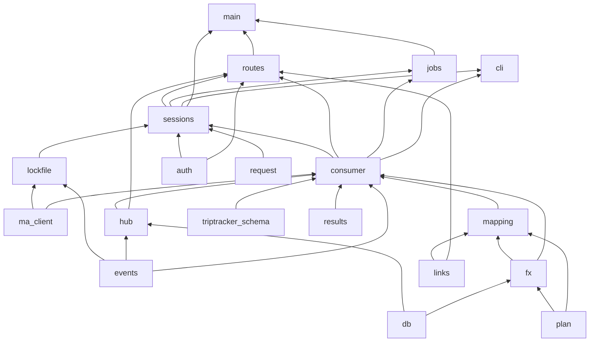

# Backend interfaces

The seams between the backend modules, as built. Every module listed below is implemented in
`backend/app/` (the fake Managed Agents client and the demo's client are in
`backend/tests/fakes/`). This page records who calls what, the flows that cross modules, and
the decisions taken while building them.

**The signatures are the contract.** When a signature must change, change the module, this
page and every caller in the same PR. For `ManagedAgentsClient`, the fake changes too. The
docstrings say what each function does: inputs, outputs, errors and side effects. Section and
decision numbers are stable, because code and other docs cite them ("§3", "decision 23").

The spec is `docs/spec/implementation-doc.it.md`. Facts the code relies on:

- `docs/managed-agents-notes.md` (cited as "notes §x"): the API, the SDK and their pitfalls.
- `docs/triptracker/schema-notes.md`: TripTracker's real Trip shape and auth.
- `docs/research/integrations.md`: booking hosts, FX sources and their fixtures.

Statements tagged [INFERRED] are unverified and wait for the live probes in notes §4 (open items
in §8).

Contents:

1. Modules, spec sections and tests
2. Dependency graph and import rules
3. Process wiring (main.py) and test hooks
4. Cross-module calls, by caller
5. Flows
6. Decisions
7. Contracts with events.py, the database, config, the web app and the agents
8. Open items that can still move a seam

---

## 1. Modules, spec sections and tests

| Module | Responsibility | Spec section | Built by |
|---|---|---|---|
| `app/ma_client.py` | `ManagedAgentsClient` Protocol, value types, errors, helpers; `SdkManagedAgentsClient` over `anthropic==1.13.0` (which runs on `httpx2`) | Backend FastAPI; Log e resilienza; Costi | A |
| `tests/fakes/__init__.py`, `tests/fakes/README.md`, `tests/fixtures/ma/*.jsonl` | `FakeManagedAgentsClient`: scripted JSONL replay, recording, fault injection; 14 scenarios | Test e verifica; CLAUDE.md "Testing offline" | A |
| `tests/fakes/demo.py` | `DemoManagedAgentsClient`: the DEMO_MODE client, the scenarios replayed at their recorded pace (decision 32) | Interfaccia e design (UI work without cost) | R |
| `app/consumer.py` | One task per plan: streams to UI events, `submit_plan`, idle handling, resume; `EventSink` persistence; the plan's lease across processes (`PlanLease`, decision 31) | Backend FastAPI, consumer steps 1-6 | B, R |
| `app/events.py` (`normalize`) | Managed Agents event to `UIEvent`, Italian titles | Backend FastAPI, `UIEvent` | C |
| `app/mapping.py` | `plan_to_trip()`, a pure function | Contratto del piano, mapping table | D |
| `app/links.py` | Booking-link domain allowlist | Sicurezza e privacy | D |
| `app/triptracker_schema.py` | Fetch and keep trip.json; `validate_trip()` | Contratto del piano, "Una sola fonte di verità" | D |
| `app/fx.py` | `FxConverter`: Banca d'Italia, then InforEuro, with the `fx_rates` cache | Conversione delle valute | E |
| `app/auth.py` | `current_user()`, `require_origin()`, `require_admin()`; the atlas session lookup (`verify_atlas_session`) and TripTracker's get-session cache | Autenticazione e domini | F |
| `app/hub.py` | In-memory per-plan pub/sub for SSE | Backend FastAPI step 3; "Un solo processo" | F |
| `app/routes.py` | Every endpoint except /health; SSE; CORS policy; the request body cap | Endpoint table; SSE verso il browser | F |
| `app/main.py` | `create_app()`, the error envelope of framework errors (decision 20), lifespan wiring (§3) | Deploy e configurazione | F |
| `app/sessions.py` | Start, interrupt, continue, resume; the `PlannerServices` container; `PlanLocks`; the local demo's wiring (decision 32) | Backend FastAPI; Costi (budget, monthly limit) | G, R |
| `app/lockfile.py` | Read `backend/claude-lock.<profile>.json` and resolve the profile's roster | Agenti; Eval e versioning | G |
| `app/jobs.py` | Nightly cleanup (Railway cron); hourly stuck-plan check (in the web process) | Lavori pianificati; Log e resilienza | G |
| `app/cli.py` | `python -m app.cli run` / `replay` / `import-evals` | Piano di lavoro, giorno 1 | G |
| `app/evals_store.py` | The eval history: validate, summarize and store the JSON of `evals/run.py` (`eval_runs`); the list and detail readers (decision 35) | Eval sui piani | S |

The contract models (`plan.py`, `request.py`, `results.py`, `events.UIEvent`), `db.py`,
`config.py`, `clock.py` and `schemas.py` predate this split. R is the later runtime pass: the
local demo, the plan lease and the logging context (decisions 31-33).

Tests. Every test is offline: it uses the fake, respx (for the backend's own `httpx` traffic
only) and time-machine, and never a real key.

| Built by | Tests |
|---|---|
| A | `test_ma_client.py` (the SDK client over `httpx2.MockTransport`, never respx: request bodies, raw SSE, error mapping, retries, deadlines; list in tests/fakes/README.md, "Not the fake's job"), `test_fake_client.py` (every scenario played by a minimal reference consumer), `test_fixture_shapes.py` (scenarios against the SDK union, plan verdicts, results envelopes, trip.json) |
| B | `test_consumer.py` (pure decisions, `EventSink`, every scenario end to end), `test_consumer_resume.py` (the spec's "Ripresa" row: restart, an interrupt requested before the restart, a listing that fails halfway) |
| C | `test_events.py` (every known type becomes a UIEvent, unknown types a generic event, never an exception; titles; no tool results in `detail`) |
| D | `test_mapping.py`, `test_mapping_budget.py` (notes <= 4000 at every line's maximum), `test_contract.py`, `test_links.py`, `test_triptracker_schema.py` |
| E | `test_fx.py` (respx with `tests/fixtures/fx/*`, the test vectors in integrations.md §2.3, the cache on Postgres) |
| F | `test_auth.py`, `test_hub.py`, `test_routes.py`, `test_sse.py` (the route's protocol, with `stub_planner` and the reference replay reader; the settle-before-end cases) |
| G | `test_lockfile.py`, `test_sessions.py`, `test_jobs.py`, `test_cli.py` (replay through the fake) |
| S | `test_evals_store.py` (validation, the list fields, idempotency, concurrent uploads), `test_evals_routes.py` (bearer token, size caps, the read side) |
| R | `test_demo.py` (the settings guard, the paced scenarios, `?demo_scenario=`, whole demo runs through `create_app`), `test_plan_lease.py` (one consumer per plan across two registries on one database; no Managed Agents call without the lease), `test_logging_context.py` (the plan keys on every line, those of other modules included) |
| Integration | `test_e2e_offline.py`: the whole spec flow through the real app (§3, "End to end") |

---

## 2. Dependency graph and import rules

Layers, lowest first. A module imports only from modules in **earlier** rows. That keeps the
graph acyclic. The parentheses list what each module actually imports.

```
 1  config  clock
 2  db (config)
 3  plan ; request (clock, plan) ; results (plan) ; events      contracts
 3  evals_store (db)                                            eval history: models, service
 4  links                                                       pure, stdlib only
 5  ma_client (config)                                          the only importer of `anthropic`
 6  lockfile (config, events, ma_client)
    hub (db, events)
    fx (clock, db, plan)
    triptracker_schema (clock, config)
    auth (clock, config, db)
 7  mapping (fx, links, plan)                                   pure
 8  consumer (clock, config, db, events, fx, hub, ma_client, mapping, plan, results,
              triptracker_schema)
 9  sessions (auth, clock, config, consumer, db, events, fx, hub, lockfile, ma_client, request,
              triptracker_schema; tests.fakes.demo imported lazily in DEMO_MODE)
10  routes (auth, config, consumer, db, evals_store, events, hub, links, ma_client, request,
            sessions, triptracker_schema)
    jobs (clock, config, consumer, db, ma_client, sessions)
    cli (auth, clock, config, consumer, db, evals_store, events, hub, ma_client, request,
         sessions, triptracker_schema; tests.fakes imported lazily inside `replay`)
11  main (config, db, jobs, routes, sessions)
    schemas (events, plan, request, results)                    the JSON Schema exporter
```



Rules that keep the seams honest:

- **Only `ma_client` imports `anthropic`** (and `httpx2`). Every other module uses the
  Protocol and its value types, so the fake replaces it completely.
- **`mapping` is pure.** It does no I/O, reads no clock and generates no randomness of its own:
  `now`, `fx` (pre-fetched `FxRates`) and `ids` are parameters.
- **Only `EventSink` writes `events`.** The consumer, sessions and jobs all go through it (or
  `consumer.set_plan_status`), so each status change and its event commit together.
- **`sessions` must not import `jobs`.** main.py starts the stuck checker (§3).
- `events.ACTION_EVENT_TYPES` is a copy of `consumer.ACTION_EVENT_TYPES` (events sits below
  consumer); `test_events.py` asserts they are equal.
- `TYPE_CHECKING`-only imports are free.

---

## 3. Process wiring (main.py) and test hooks

`create_app(settings=None)` configures logging, builds the FastAPI app, registers the error
envelope handlers (`envelope_http_exception` for every `HTTPException`, `envelope_server_error`
as Starlette's last resort), adds GET /health and `UnhandledErrorMiddleware`, then calls
`routes.install_routes(app, settings)` (the router, the request body cap of decision 20 and the
CORS policy of decision 23). Middleware order, outermost first: CORS, the body cap,
`UnhandledErrorMiddleware`, routing; so a 500 still carries the CORS headers (decision 20). The
interactive docs and `/openapi.json` exist only outside production. Logging is structlog JSON
(decision 33): `main.configure_logging`, and the same processors in `app.jobs` and `app.cli`.
The lifespan:

```python
@asynccontextmanager
async def lifespan(app):
    settings = app.state.settings
    engine = create_engine(settings); session_factory = create_session_factory(engine)
    app.state.engine, app.state.session_factory = engine, session_factory
    http = httpx.AsyncClient(follow_redirects=False)
    try:
        planner = await sessions.start_planner(
            settings, session_factory=session_factory, http=http,
            client=getattr(app.state, "planner_client_override", None),
        )                                             # resume=True, fx_offline=False
        try:
            planner.background_tasks.append(jobs.start_stuck_plan_checker(planner))
            app.state.planner = planner                              # routes.get_planner
            app.state.hub = planner.hub                              # SSE
            app.state.session_verifier = planner.session_verifier    # auth.current_user
            yield
        finally:
            await sessions.stop_planner(planner)
    finally:
        await http.aclose()
        await engine.dispose()
```

`sessions.start_planner(settings, *, session_factory, http, client=None, resume=True,
fx_offline=False)` builds, in order: `PlanHub`, `SessionVerifier`, `TripSchemaStore` and its
`load()`, `FxConverter`, the Managed Agents client (`client` if given, else
`SdkManagedAgentsClient.from_settings` when Settings has Anthropic credentials: a key, or
federation in development), the roster
(`lockfile.load_roster`), `ConsumerDeps` and `ConsumerRegistry`. When trip.json did not load
(production without TripTracker), it adds a background task running
`TripSchemaStore.retry_until_loaded()`. Then, with `resume`, it calls `resume_running_plans`.
With DEMO_MODE (decision 32) the client is `tests.fakes.demo.DemoManagedAgentsClient` (a given
`client` still wins), the roster is `sessions.demo_roster()`, trip.json is the vendored copy and
FX is offline. `stop_planner` first gives in-flight session cleanups (`cleanup_tasks`, decision
30) up to `SHUTDOWN_CLEANUP_GRACE_SECONDS` (10 s), then cancels the background tasks (the stuck
checker, the trip.json retry, the "Continua" nudges, those cleanups), closes the registry (plans
stay `running` for the next process) and the client.

`start_planner` never raises for a missing API key, lockfile or trip.json: `/health` stays up,
the reasons are logged, and POST /plans answers 503 `planner_unavailable`. A real plan needs
all three: a key, `backend/claude-lock.<AGENT_PROFILE>.json` written by `ant apply`, and
trip.json (TripTracker, `TRIP_SCHEMA_URL=file://...`, or the vendored copy in development).
A demo plan needs none of them, only `backend/tests` on disk (it is not in the Docker image).
The stuck checker runs one check at startup, then every hour.

Test hooks (tests/conftest.py):

- `make_app(settings=..., client=fake)`: the real wiring against `FakeManagedAgentsClient`
  through `app.state.planner_client_override`, with the lifespan running.
- `stub_planner`: replaces `start_planner`, `stop_planner` and the stuck checker with a minimal
  `PlannerServices` (real hub and verifier, no client, roster or registry). API tests use it to
  stay independent of the lifecycle.
- `stub_event_replay`: replaces `consumer.load_events_after` with a plain query, for SSE
  protocol tests.
- `plan_rows`: inserts `plans` and `events` rows directly.

**End to end** (`tests/test_e2e_offline.py`): `make_app(client=fake)` with the real lifespan
(resume and the stuck checker included), local auth, the fixture lockfile
(`app.cli.REPLAY_LOCKFILE_DIR`), trip.json served by respx at `TRIP_SCHEMA_URL` (every other
outgoing `httpx` request fails), and time frozen with a tick on the scenarios' day, early enough
that Postgres's `now()` is never behind the app's clock. A restart is two app instances on one
fake and one database. The FX converter runs online there: the scenarios' prices are EUR only,
so it never needs the network. A real-wiring test with non-EUR prices must mock the FX hosts
with respx, or wrap `start_planner` with `fx_offline=True` (as `test_sse.py` and `app.cli
replay` do).

---

## 4. Cross-module calls, by caller

Signatures are abbreviated where the code has more keyword defaults; the code is authoritative.

### routes -> ...

| Callee | Signature | Used for |
|---|---|---|
| auth | `current_user(request) -> CurrentUser` (via `CurrentUserDep`) | every route |
| auth | `require_origin(request) -> None` (via `RequireOrigin`) | POST routes |
| auth | `require_admin(request, user) -> None` (via `RequireAdmin`) | GET /evals/runs* |
| sessions | `plan_owner_filter(user, *, settings) -> ColumnElement[bool]` | GET /plans |
| sessions | `get_user_plan(db, plan_id, user, *, settings) -> PlanRecord` (raises `consumer.PlanNotFoundError`) | GET /plans/{id}, /events, /trip, /cover |
| sessions | `start_plan(request: PlanRequest, user: CurrentUser, *, services: PlannerServices, demo_scenario: str \| None = None) -> uuid.UUID` | POST /plans (`demo_scenario` from `?demo_scenario=`, checked first by `routes.check_demo_scenario` against `services.demo_scenarios`) |
| sessions | `interrupt_plan(plan_id, user, *, services) -> PlanStatus` | POST /plans/{id}/interrupt |
| sessions | `continue_plan(plan_id, user, *, services, extra_cents=200) -> int` | POST /plans/{id}/continue |
| sessions | `get_user_plan(db, plan_id, user) -> PlanRecord` (raises `consumer.PlanNotFoundError`) | every `{id}` route |
| consumer | `load_events_after(db, plan_id, after_seq: int \| None, *, limit=1000) -> list[UIEvent]` | SSE replay, in pages of `REPLAY_PAGE_SIZE` |
| consumer | `services.registry.get(plan_id) -> PlanConsumer \| None`, `PlanConsumer.wait_settled()` | SSE: the end waits for a winding-down consumer (decision 22b) |
| hub | `PlanHub.subscribe(plan_id) -> ContextManager[Subscription]`; iterating yields `UIEvent \| PlanEnded`, may raise `SubscriptionLaggedError` | SSE live |
| links | `check_link(url, *, providers=None) -> LinkVerdict` | `PlanDetail.booking_links`, `.alternative_links` |
| errors caught | `sessions.MonthlyLimitReachedError` (429), `sessions.PlannerUnavailableError` and `triptracker_schema.TripSchemaUnavailableError` (503), `sessions.PlanStateError` (409), `consumer.PlanNotFoundError` (404), `ma_client.ManagedAgentsError` and the start `TimeoutError` (502); `?demo_scenario=` without DEMO_MODE is 404 `demo_unavailable`, an unknown name a FastAPI-shaped 422 on `["query", "demo_scenario"]` | error envelope (decision 20) |

### sessions -> ...

| Callee | Signature | Used for |
|---|---|---|
| lockfile | `load_roster(settings) -> Roster` (`LockfileError`); `Roster.agent_versions(*, git_sha, trip_schema_sha256) -> dict` | startup; `plans.agent_versions` |
| ma_client | `SdkManagedAgentsClient.from_settings(settings)` | startup |
| ma_client | `create_session(*, agent: AgentPin, environment_id, budget_cents, metadata, title=None) -> SessionInfo` | start |
| ma_client | `send_interrupt(session_id, thread_id=None)` (no thread id: every thread), `retrieve_session(session_id) -> SessionInfo`, `update_budget(session_id, budget_cents) -> SessionInfo`, `send_user_message(session_id, text)` | interrupt, continue, the continue nudge |
| ma_client | `archive_when_idle(client, session_id)` | interrupt without a live consumer, `budget_paused` interrupt |
| triptracker_schema | `TripSchemaStore(settings, http)`, `.load() -> TripSchema \| None`, `.current()`, `.require() -> TripSchema`, `.retry_until_loaded()` | startup; start precondition; production retry |
| fx | `FxConverter(*, session_factory, http, offline=False)` | startup |
| hub | `PlanHub()` | startup |
| auth | `SessionVerifier(settings, http)` | startup |
| consumer | `ConsumerDeps(settings, session_factory, client, hub, trip_schema, fx, now, ids=RandomTripIds, sleep=asyncio.sleep)`, `ConsumerRegistry(deps)`, `.start(plan_id, session_id, *, first_message=None) -> PlanConsumer`, `.get(plan_id)`, `.stop(plan_id, *, grace_seconds=10.0)`, `.aclose()` | start, resume, continue, shutdown |
| consumer | `PlanConsumer.wait_started()` (bounded by `consumer.START_TIMEOUT_SECONDS`, decision 30), `.request_interrupt()`, `.done` | start, interrupt |
| consumer | `EventSink(plan_id, *, session_factory, hub).emit(build, *, ma_event_id, update=None) -> EmitResult` (`PlanUpdate.interrupt_requested_at`, `.budget_cents`); `set_plan_status(session_factory, hub, plan_id, StatusChange, *, title, event_key, budget_cents=None)`, `event_key` unique per occurrence; `backend_event(kind, title, *, ts, ...)`, `backend_event_id(plan_id, name, key)` | status changes and their events |
| consumer | `record_session_cost(client, sink, session_id, *, known_cents=None) -> int \| None` | the final cost of a session no consumer follows: a start that timed out, an interrupt without a live consumer (decision 11b) |
| tests.fakes.demo | `DemoManagedAgentsClient(pace=settings.demo_pace)`, `demo_scenarios() -> tuple[str, ...]` (lazy import, DEMO_MODE only) | startup (decision 32) |

Also exported by sessions: `request_interrupt(services, plan, *, reason, interrupted_key=None,
request_title=TITLE_INTERRUPT_REQUESTED) -> PlanStatus` (the `running` branch of
`interrupt_plan` without the ownership check, used by jobs), `resume_running_plans(services)`,
`monthly_spend_cents(db, *, now)`, `month_bounds(now)`, `session_metadata(plan_id, profile)`,
`build_brief(request, *, today)` (decision 29), `backend_git_sha(settings)`, `PlanLocks`
(decision 31), and for the demo `demo_roster(profile) -> Roster`, `DEMO_SESSION_PREFIX`
(`"sesn_demo_"`), `DEMO_SCENARIO_METADATA`, `DEFAULT_DEMO_SCENARIO` (`"happy_path"`),
`REASON_DEMO_ENDED`. `PlannerServices.demo_scenarios` holds the names the demo accepts (empty
outside DEMO_MODE).

### consumer -> ...

| Callee | Signature | Used for |
|---|---|---|
| ma_client | `stream_session(sid)` / `stream_thread(sid, tid)` -> `AsyncContextManager[AsyncIterator[RawEvent]]` | steps 1-2 |
| ma_client | `iter_session_history(client, sid, *, since=None)`, `iter_thread_history(client, sid, tid)`, `list_threads(sid) -> list[ThreadInfo]` | backfill, resume, first-message check |
| ma_client | `archive_thread(sid, tid)` | an idle thread superseded by a newer thread of the same agent |
| ma_client | `send_user_message(sid, text)` | the first message |
| ma_client | `send_custom_tool_result(sid, tool_use_id, content, is_error)` | step 4 |
| ma_client | `send_interrupt(sid)` | after the 3rd failed submission, or trip.json unavailable |
| ma_client | `usage_from_event(raw) -> SessionUsage \| None`; `retrieve_session(sid)` (through `record_session_cost`) | cost; the final cost read (decision 11b) |
| ma_client | `archive_when_idle(client, sid)` | ready, interrupted |
| Postgres | its own `PlanLease(plan_id, session_factory)`: `.try_acquire() -> bool` (`pg_try_advisory_lock(plan_lease_key(plan_id))`), `.release()`, on a private `NullPool` autocommit engine; `load_latest_event(db, plan_id)` | the plan's lease; the relay while another process holds it (decision 31) |
| events | `normalize(raw, *, seq, agent, cost_cents=None, duration_ms=None) -> UIEvent \| None` | step 3 |
| plan | `Plan.model_validate`, `plan_rejection_message(error) -> str`, `describe_validation_errors` | step 4 |
| results | `parse_result(agent_name, data) -> AnyResult` | logged result checks (decision 11) |
| fx | `fx_keys(plan) -> set[FxKey]`, `FxConverter.prefetch(keys) -> FxRates` (never raises: misses go to `FxRates.missing`) | step 4 |
| triptracker_schema | `TripSchemaStore.require() -> TripSchema`, `TripSchema.validate(trip) -> list[TripSchemaError]` | step 4 |
| mapping | `plan_to_trip(plan, *, now, fx, ids) -> TripMapping`; `RandomTripIds` | step 4 |
| hub | `PlanHub.publish(plan_id, event)`, `PlanHub.end(plan_id, status)` (from `EventSink`, after each commit) | live UI |

The submit pipeline is public for tests: `parse_submission(tool_input) -> Plan | Rejected`,
`translate_submission(plan, *, schema, fx, now, ids) -> Accepted | Rejected`,
`evaluate_submission(tool_input, *, deps) -> Accepted | Rejected`,
`check_result_writes(writes) -> dict[str, list[str]]`. So are the pure decisions:
`decide_idle`, `stream_owns`, `dedupe_key`, `lane_for`, `superseded_threads`,
`is_terminal_error`, `backoff_delay`, `plan_lease_key`, and `PlanConsumer.leased` (True while it
holds the lease).

### mapping, fx, jobs, cli, main -> ...

| Caller | Callee | Signature |
|---|---|---|
| mapping | fx | `FxRates.get(currency, on_date) -> FxQuote \| None` (EUR: an identity quote), `price_fx_date(price) -> date`, `FxQuote.to_eur_cents(amount_cents) -> int` |
| mapping | links | `check_link(url) -> LinkVerdict` |
| mapping | plan | `Plan.trip_dates() -> list[date]`, `Plan.iter_stops()` |
| fx | db | `FxRateRecord` (`fx_rates`: date, currency, rate, source) |
| jobs | ma_client | `delete_session(sid)`, `send_interrupt(sid)`, `wait_until_not_running(client, sid)`, `archive_when_idle(client, sid)`, `list_sessions(*, created_before, include_archived=True) -> list[SessionInfo]` (orphan sweep), `SdkManagedAgentsClient.from_settings` (cron) |
| jobs | sessions | `request_interrupt(services, plan, *, reason, interrupted_key, request_title)`, `start_planner(..., resume=False)` / `stop_planner` (`python -m app.jobs stuck`) |
| jobs | consumer | `set_plan_status(...)`, `ConsumerRegistry.stop(plan_id)`, `EventSink`, `record_session_cost(...)` (a stuck plan forced to `interrupted`) |
| cli | sessions | `start_planner(..., client=..., resume=False, fx_offline=...)`, `start_plan(...)`, `interrupt_plan(...)`, `stop_planner(...)` |
| cli | hub, consumer | `PlanHub.subscribe(plan_id)` (a wake-up only), `load_events_after(...)` (the source of truth), `set_plan_status(...)` (a replay left `running` becomes `interrupted`) |
| cli | tests.fakes | `FakeManagedAgentsClient.from_jsonl(path)` (lazy import in `replay`) |
| main | sessions, routes, jobs | `start_planner`, `stop_planner`, `install_routes(app, settings)`, `start_stuck_plan_checker(services, *, interval_seconds=3600.0) -> asyncio.Task[None]` |

---

## 5. Flows

### POST /plans

```
routes.create_plan --(Origin check: 403 bad_origin; PlanRequest validated by FastAPI: 422)
  check_demo_scenario(?demo_scenario=)       -> 404 demo_unavailable / 422 (decision 32)
  sessions.start_plan                        # binds plan_id, then session_id (decision 33)
    services.require_ready()                 -> 503 planner_unavailable (no key or roster)
    trip_schema.require()                    -> 503 planner_unavailable (nothing spent yet)
    monthly_spend_cents(now) >= MONTHLY_LIMIT -> 429 monthly_limit_reached {spent_cents, limit_cents}
    INSERT plans (running, running_since=now(), request, agent_versions) + event "Piano avviato"
    client.create_session(coordinator pin, env, budget_cents, metadata)   -> 502, plan failed
    UPDATE plans.session_id, plans.budget_cents
    registry.start(plan_id, sid, first_message=build_brief(request, today))
      consumer: take the lease -> open session stream -> send user.message -> started
    await consumer.wait_started()  (asyncio.timeout START_TIMEOUT_SECONDS = 75 s)
      timeout -> 502, consumer stopped, plan failed, and in the background the session is
                 interrupted, archived and its cost recorded (decision 30)
  201 {"id": plan_id}
```

### The consumer loop (one event)

Before the first stream opens the consumer takes the plan's lease (decision 31). While another
process holds it, it opens nothing, relays that process's latest stored event to its own hub
every `LEASE_RETRY_SECONDS` (2 s), and returns as soon as the plan leaves `running`. Each event
below is handled with its lane and type bound in the logging context (decision 33).

```
raw  (from the session stream or a thread stream, through one inbox, in arrival order)
  if not stream_owns(scope, raw): drop
  key = dedupe_key(raw, plan_id=..., scope=...)  # id; empty id -> noid:<plan>:<scope>:<type>:<processed_at>;
                                                 # empty id and no processed_at -> None: not stored
  lane = lane_for(raw, scope=..., state=...)
  a status event to act on, no plan accepted, no interrupt known?
     -> re-read plans.interrupt_requested_at (another process may have stored a request)
  sink.emit(lambda seq: normalize(raw, seq=seq, agent=lane, cost_cents=state.cost_cents,
                                  duration_ms=<paired tool use -> result>),
            ma_event_id=key, update=<plan change caused by raw, if any>)
     -> duplicate? stop here (already handled before a restart)
  act: thread_created -> follow thread (open stream, then backfill its history)
       thread idle (end_turn) -> archive it if superseded_threads(state) names it
       session.usage   -> state.cost_cents (the update above stored it)
       custom_tool_use on the session stream -> submit_plan handling
       status_idle     -> decide_idle (the update above applied the status)
       error terminal / terminated / deleted -> ready if accepted, interrupted if asked, else failed
when the consumer stops (any decision):
  wait (at most SETTLE_BACKFILL_WAIT_SECONDS = 5 s) for thread histories still being listed
  store what is still in the inbox (no actions)  ->  settled (decision 22b)
  failed for a backend-side reason (crash, API errors, lost stream) -> user.interrupt
  record_session_cost: raise plans.cost_cents to the session's list cost (decision 11b)
  ready / interrupted -> archive_when_idle
  release the lease, then `done`
```

Lanes: a thread stream's events go to that thread's agent. On the session stream, an event
naming a subagent (`agent_name`, `session_thread_id`, `from_agent_name`/`to_agent_name`) goes
to that subagent, and so does a `session.error` naming an `mcp_server_name` that a subagent
called last (decision 11c). Everything else goes to the coordinator.

### submit_plan

```
agent.custom_tool_use(id=U, name=submit_plan, input)   # on the session stream only
  already answered in history? -> skip.  already evaluated (backend:<plan>:submit:U stored)? -> resend that answer
  plan accepted earlier? -> answer PLAN_ALREADY_ACCEPTED_TEXT
  other name -> answer UNKNOWN_TOOL_TEXT (is_error)
  outcome = evaluate_submission(input, deps=...)
      parse_submission -> Plan | Rejected(plan)
      fx.prefetch(fx_keys(plan)); trip_schema.require()   # unavailable -> failed, interrupt
      translate_submission -> book_by in the past? Rejected(plan)
                           -> plan_to_trip -> validate_trip -> Accepted | Rejected(trip)
  check_result_writes(...) -> logged only
  sink.emit(plan event, ma_event_id=backend:<plan>:submit:U,
            update=PlanUpdate(submit_attempts+1, plan=..., trip=...))   # one transaction
  client.send_custom_tool_result(sid, U, "Plan accepted." | rejection message, is_error)
  3rd Rejected -> StatusChange(failed) in the same transaction (detail.plan_status = "failed"),
                  answer, send_interrupt, stop
```

### session.status_idle

`decide_idle(raw, state)` returns one of these, and `PlanUpdate.status` applies it in the same
transaction as the event:

| stop_reason | condition | plan | then |
|---|---|---|---|
| `requires_action` | only our `submit_plan` uses pending | (running) | keep following |
| any other | plan accepted (Trip stored) | `ready`, stop reason logged | `archive_when_idle`, `hub.end` |
| `end_turn` | interrupt requested (`plans.interrupt_requested_at`) | `interrupted` | archive, `hub.end` |
| `end_turn` | neither | `failed` ("Il coordinatore ha chiuso senza consegnare il piano.") | keep the session |
| `budget_reached` | interrupt requested | `interrupted` | archive, `hub.end` |
| `budget_reached` | not requested | `budget_paused` | consumer exits; "Continua" restarts it |
| `requires_action` | anything else pending (an MCP permission ask, a subagent's custom tool use) | `blocked`, logged | keep the session |
| `retries_exhausted`, `refusal` | | `failed` | keep the session |
| unknown | | `blocked`, logged | keep the session |

### Resume (process start, stream drop, "Continua")

```
take the plan's lease                     # a new consumer only (start, "Continua"); a reconnect holds it
open session stream                       # first, always
for raw in iter_session_history(...):     # read ALL of it before acting (two passes)
    persist unseen; remember custom_tool_use ids and the custom_tool_use_ids already answered
listing failed halfway? -> act on nothing from this pass, reconcile again on the next reconnect
for t in list_threads(sid) if not primary:
    archived -> backfill its history only (it gets no new events)
    else     -> open thread stream, then backfill its history
wait (at most RESUME_BACKFILL_WAIT_SECONDS = 30 s) until every thread's history is listed
answer submit_plan uses minus the answered ones (from the stored outcome when there is one)
act on the latest unseen status event, if any
tail the streams
```

This is the reconcile of the SDK's own session runner (notes §2f, "Reconcile"); the runner
itself is not used because the UI needs every event, not only the tool calls.

Stream drops (`StreamDisconnectedError`: a network drop, which the SDK raises as a raw
`httpx2.HTTPError`, an `event: error` SSE message, or a malformed payload; and
`ApiUnavailableError` on opening): reconnect with `backoff_delay(attempt, jitter)` (1 s, 2 s,
4 s ... capped at 30 s, jittered), at most `RECONNECT_ATTEMPTS = 5` in a row. The counter
resets after any received event. When reconnection is exhausted the plan is `failed`. A thread
stream that can't be followed is given up and logged; it never fails the plan.

At process start `resume_running_plans` starts a resume-mode consumer for every `running` plan
with a `session_id`; a `running` plan without one (a crash between insert and session creation)
becomes `failed`. Without a key or a roster the plans stay `running` for a later start. During
a redeploy's overlap both processes resume the same plans, and the lease (decision 31) lets
only one follow each. A demo plan (session id `DEMO_SESSION_PREFIX`) can't be resumed and
becomes `interrupted` (`REASON_DEMO_ENDED`); in DEMO_MODE the real `running` plans are left
alone for a later start without it.

### SSE (GET /plans/{id}/events)

```
ownership check (404)
with hub.subscribe(plan_id) as live:              # subscribe before reading Postgres
    after = parse_last_event_id(Last-Event-ID header, ?after=)
    status = read plans.status
    terminal? -> wait for the live consumer to settle (at most END_SETTLE_SECONDS)
    send load_events_after(db, plan_id, after)    # id: <seq>, data: UIEvent JSON, pages of 500
    if terminal: send `event: end` and close
    for msg in live: skip seq <= last sent
                     seq > last + 1 (a writer published out of order): send
                         load_events_after(db, plan_id, last) first, then go on
                     PlanEnded -> wait for the live consumer to settle, final catch-up
                                  from Postgres, `event: end`, close
    SubscriptionLaggedError -> replay from Postgres again, resubscribe
": ping" comment every 15 s; a write blocked for 30 s closes the stream
```

The hub is per process. When the plan's lease is held by another process, this process's
waiting consumer publishes the latest stored event (the gap rule above reads the rest from
Postgres) and `hub.end` once the plan is terminal, so a browser connected here still follows
the plan and gets its `end`.

### "Continua con 2 $ in più" (POST /plans/{id}/continue)

`budget_paused` only (else 409). Everything from the status read to the restart runs under the
plan's lock (`PlanLocks`, decision 31), so a double click or an interrupt racing it waits and
then sees the new status. Monthly check with the extra $2 included (`spent + 200 > limit` ->
429). Then:

1. `retrieve_session`; budget = `max(current cap, consumed list cost) + 200` (consumed falls
   back to `plans.cost_cents`), set with `client.update_budget`. An API error is 502 and the
   plan stays `budget_paused`.
2. Status `budget_paused` -> `running`, with a status event keyed `continue:<new budget>`,
   storing `plans.budget_cents` and restarting `plans.running_since` in the same transaction;
   `status_applied` False raises `PlanStateError`.
3. A paused consumer still winding down is stopped, then `registry.start(...)` in resume mode
   (the old `budget_reached` idle is already stored, so it is not acted on).
4. [INFERRED, probe P9] After `CONTINUE_RESUME_WAIT_SECONDS` (5 s), if the plan is still
   `running`, the session `idle` and its cost unchanged, send `CONTINUE_MESSAGE`.

The notes (§2d) say a budget can be raised at any time to a value above consumption, and that
only a budget update lets a `budget_reached` session go on. The fake resumes by itself after
the update (fixture assumption, P9).

### Interrupt (POST /plans/{id}/interrupt)

Under the plan's lock (`PlanLocks`, decision 31), like "Continua":

- `running`: store "Interruzione richiesta" with `plans.interrupt_requested_at` in one
  transaction, tell the live consumer, send `user.interrupt` (no thread id: every thread).
  Answer 202 `running`; the consumer turns the coming idle into `interrupted` (or `ready` when
  a plan was already accepted), archives the session and ends the stream. The live consumer
  may be one waiting for the lease while another process follows the plan: the stored request
  reaches that process's consumer, which re-reads it before a status decision. Without a live
  consumer the plan becomes `interrupted` at once, the session is archived and its final cost
  recorded (`record_session_cost`).
- `budget_paused`: `interrupted` at once, archived; 202 `interrupted`.
- anything else: 409 `invalid_plan_state` with `data.status`.

### Stuck plans (jobs, inside the web process)

Every hour (and once at startup): plans `running` with `running_since < now - 45 min` get the
interrupt above (`TITLE_STUCK_REQUESTED`), then up to 60 s for the consumer to stop them;
otherwise `interrupted` with `REASON_STUCK`, the consumer stopped, the session archived and its
final cost recorded (the cancelled consumer never read it).

---

## 6. Decisions

Spec divergences are marked **(diverges)**. Each has its reason in the code's docstrings.

**Managed Agents seam (ma_client)**

1. Streams are async context managers: entering one means the HTTP stream is open. That makes
   "open the stream before the first message" explicit and testable (`SentEvent.open_streams`).
   Opening a stream is bounded by `CALL_DEADLINE_SECONDS`.
2. The SDK client iterates **raw SSE** (`AsyncStream.raw_events`). In 1.13.0 the typed
   iterator silently drops `session.usage` and every unknown event type (notes §2f). The raw
   path does the typed iterator's housekeeping itself: skip `ping` and empty data, raise
   `StreamDisconnectedError` on `event: error`, fill a missing `type` from the SSE event name
   (the payload's own `type` wins), dispatch on `data["type"]`. Iteration stops after
   `session.status_terminated` / `session.deleted` (and a thread stream after its own
   `session.thread_status_terminated`); any other end is a `StreamDisconnectedError`. Every
   listing (`list_events`, `list_thread_events`, `list_threads`, `list_sessions`) reads the
   server's JSON page by page through `with_raw_response`, never `model_dump()` (which adds
   nulls and rewrites timestamps), and follows every page under one `CALL_DEADLINE_SECONDS`.
3. `AsyncAnthropic(max_retries=4)`: the SDK's `max_retries` counts retries after the first
   attempt, so 1 + 4 = the spec's "massimo 5 tentativi". `send_user_message` runs with
   `max_retries=0`, because a retried `user.message` may be enqueued twice; the consumer checks
   the history before resending. `archive_session` / `delete_session` also run once, after
   `wait_until_not_running`, so a busy session is `SessionBusyError` at once. Every non-stream
   call is bounded by `CALL_DEADLINE_SECONDS` (a `retry-after` is honoured with no useful cap
   by the SDK).
4. Every `cost_cents` and `budget_cents` is **US cents** of list cost (budgets are USD only).
   Only TripTracker's `costCents` is euro. There is no token-based cost fallback: when
   `usage.list_cost` is absent the cost stays unknown (notes §2d, "Usage and cost").
4a. Errors are classified by HTTP status: 408/409/429/>=500 and transport errors ->
   `ApiUnavailableError`, 404 -> `SessionNotFoundError`, other 4xx -> `ApiRejectedError`;
   archive/delete answered 400/409 -> `SessionBusyError` [INFERRED, P10]. Mid-stream drops
   arrive as raw `httpx2.HTTPError`, not `APIConnectionError`; stream iteration maps them (and
   `anthropic.APIError`, `UnicodeDecodeError`) to `StreamDisconnectedError`. `error_type`
   values callers can see besides the API's own: `malformed_response` (a plain
   `ManagedAgentsError`: a body that is not the expected JSON, or a listing cursor that does
   not advance), `invalid_budget` (`ApiRejectedError` for a non-positive budget, raised before
   any request), `deadline`, `timeout`, `connection_error`. The `budget_not_raised` /
   `model_not_budgetable` reason is read from `error.reason`, then a known reason named in
   `error.message`, then `error.type` [INFERRED, P9].
4b. Tests mock the SDK with `httpx2.MockTransport`; respx never sees SDK traffic. conftest
   neutralizes every Anthropic credential variable and points `ANTHROPIC_BASE_URL` at a closed
   local port.

**Events and the consumer**

5. Dedupe: `ma_event_id` is the event id; an event with an empty id (`user.interrupt`) gets
   the deterministic key `noid:<plan>:<scope>:<type>:<processed_at>` (the instant normalized,
   so a listing and the stream agree), and one without `processed_at` (still queued) is not
   stored. NULL is never used for API events, because NULLs bypass the UNIQUE constraint and a
   resume would store them again. Cross-posted copies carry different ids, so `stream_owns()`
   persists each copy from one stream only [INFERRED, P7]: thread lifecycle, inter-agent
   messages and every `session.*` event from the session stream; everything else a subagent
   does from its thread stream. Backend-made events use
   `backend:<plan>:<name>:<key>`, with a key unique per occurrence (`continue:<budget>`,
   `interrupted:<uuid4>`, `cost:<cents>`, ...). The global UNIQUE on `events.ma_event_id`
   stays as is **(diverges** from notes §3.8's suggestion to scope the key per stream;
   ownership plus synthetic keys make that unnecessary).
6. "Seen implies handled": an event that changes the plan commits together with the change.
   On resume only the latest unseen status event is acted on.
6a. After its last decision the consumer still stores what its streams had already delivered
   (with no actions): a thread's backfill often lands after the session's decisive idle. So a
   terminal status is not always a plan's last stored event; decision 22b keeps the browser
   complete anyway.
7. `end_turn` without an accepted plan -> `failed`, with no automatic nudge (it would spend
   money outside the spec's flow). The spec leaves this case open. Once a plan is accepted
   (its Trip stored), every later idle except our own pending `submit_plan` answer ends the
   plan `ready`, whatever the stop reason (`budget_reached`, `refusal`, ...): the user never
   pays $2 more or loses a validated plan for what happens after acceptance.
7a. An interrupt request is persisted (`plans.interrupt_requested_at`, written with its status
   event) before `user.interrupt` is sent, so a consumer resumed after a restart still ends
   the plan `interrupted`. `budget_reached` after an interrupt request is `interrupted` too.
   The failure reason differs by path: "Interrotto su richiesta." when the consumer ends it,
   "Interrotto da te." when sessions does (no live consumer, or `budget_paused`), and
   `REASON_STUCK` when the stuck check forces it.
8. Sessions are archived on `ready` (spec) and on `interrupted`. Failed and blocked sessions are
   kept for inspection until the 90-day job. Child threads are archived only when superseded
   by a newer thread of the same agent (25 concurrent child threads at most; this roster stays
   far below) [INFERRED, P6]. On resume, archived child threads are backfilled from their
   history only, with no stream.
9. A `submit_plan` call after acceptance is answered "already accepted" and not
   re-evaluated.
10. **(diverges)** The spec says the backend writes `/workspace/shared/request.json` at start.
    The client surface here can't write into the sandbox without a Files resource, so the brief
    asks the coordinator to write it [INFERRED] (decision 29).
11. Subagent result files are validated **best-effort from `write` tool inputs** seen on the
    thread streams, and logged only [INFERRED]. The backend cannot read the sandbox directly,
    and a results file written by `bash` (heredoc, `echo`) is not checked.
11a. Only the coordinator's (session-stream) `agent.custom_tool_use` calls are answered:
    subagents have no custom tool. A `requires_action` idle waiting on a custom tool use made
    on a subagent thread ends the plan `blocked`. If the roster ever gives subagents a custom
    tool, the consumer must also answer thread-scope uses (their cross-posted ids: P7).
11b. When the consumer stops, one `retrieve_session` raises `plans.cost_cents` to the session's
    `usage.list_cost` if no `session.usage` carried it (notes §2d). It stores no event and never
    lowers the cost; a failure is logged. The read is `consumer.record_session_cost`, shared by
    every path that stops following a session: the consumer, sessions (a start that timed out,
    an interrupt without a live consumer) and jobs (a stuck plan forced to `interrupted`), so
    the monthly limit counts what those sessions spent.
11c. A `session.error` naming an `mcp_server_name` goes to the lane of the agent that last
    called that server.

**Mapping, FX, links, schema**

12. dueAt fallback = `scheduled_for` minus `DEFAULT_LEAD_DAYS[kind]` (same wall-clock time in
    the trip zone, across DST). The floor is `now` + 1 day in the trip zone, truncated to the
    minute. If the result is not strictly before `scheduled_for`, dueAt is **omitted**, with a
    "Da prenotare subito" note and a warning, so rule 1 (`dueAt < scheduledFor`) is never broken
    (schema-notes A9).
13. A booking link outside the allowlist goes to the booking notes as text, never into
    `Booking.url` (TripTracker would render it clickable). Stop URLs must be absolute
    `https://` URLs with a host and no user info (`Plan` rejects `javascript:` and the like);
    they are informational (official site, map) and not domain-checked, because no allowlist
    of official sites exists and they never lead to a payment (residual risk accepted).
13a. `check_link` is stricter than integrations.md §1.12: besides the host and path rules it
    rejects non-ASCII and `xn--` hosts (even under an allowed suffix), spaces, control
    characters and backslashes anywhere in the URL (browsers read `\` as `/`), trailing-dot and
    IP hosts, and dot segments under Google's `/travel/flights` (its open redirect). A real MCP
    link with a raw space is shown as text.
14. Notes cap 4000, a hard budget: the plan's own notes are shortened first; the provenance
    lines are bounded by the contract (`book_by_reason` <= 300, URLs <= 2000), so with today's
    caps cutting the unchecked link to 200 characters plus "…" always brings the notes under
    4000, and the room it frees goes back to the plan's own notes. Cutting the price source
    URL, and a final hard cut, remain as safety nets (A10; tests/test_mapping_budget.py).
14a. A `book_by` in the past is rejected back to the agent (`translate_submission`, stage
    `plan`), so a booking never lands in TripTracker already overdue.
15. FX date = the price's `retrieved_at` date in Europe/Rome. Only `plan.bookings` prices are
    converted; alternatives stay in the planner. EUR is an identity quote (no conversion note,
    no network). A missing rate leaves the original amount in the notes and adds a plan
    warning; FX notes write the rate with an Italian decimal comma (at most 6 decimals; the
    conversion uses the exact rate) and dates as dd/mm/yyyy.
15a. **(diverges** from integrations.md §2.3 step 2) A cached Banca d'Italia daily row counts as
    a hit only when no publication day (Mon-Fri except the TARGET holidays: 1 Jan, Good Friday,
    Easter Monday, 1 May, 25-26 Dec) falls between its date and the asked date; Friday's rate
    still answers for the weekend. An older cached row is used when Banca d'Italia fails or
    returns nothing, before InforEuro (the month, then the previous month on "no rates
    published"). Offline mode: any cached daily row in the 7-day window, then the cached
    InforEuro month, then the previous month. `prefetch` never raises except on cancellation:
    `FxUnavailable`, a malformed currency and unexpected errors go to `FxRates.missing`; cache
    write failures are logged and skipped. Worst case when both hosts hang: about 20 s per
    source (`SOURCE_DEADLINE_SECONDS`), so a submission can wait about 40 s.
16. trip.json: **development falls back** to the vendored fixture. **Production never does**:
    POST /plans answers 503 until the schema loads. `start_planner` then runs
    `TripSchemaStore.retry_until_loaded()` in the background (every 30 s), and `require()`
    also retries on its own at most every 30 s. `TripSchemaStore.last_error` is the English
    reason for logs. `TRIP_SCHEMA_URL=file://...` is the explicit way to pin a copy in
    production before TripTracker serves the file (A16): the image ships
    `backend/pinned/trip.schema.json` (`file:///app/pinned/trip.schema.json`, byte-identical to
    the development fallback, and the Dockerfile fails the build without it). `plans.agent_versions` records the
    schema's `sha256` (canonical JSON). Once loaded, the schema is **refreshed** (the spec
    says "all'avvio"; TripTracker regenerates trip.json on every build while the planner runs
    for weeks): `require()`, awaited by POST /plans and by every `submit_plan` evaluation,
    downloads it again when the copy in use was last checked `REFRESH_SECONDS` (600 s) ago.
    A changed sha256 is logged (`trip_schema_changed`, warning) and takes over at once, so a
    tightened cap is rejected back to the agent instead of failing at /import. A failed
    refresh keeps the last good copy (`trip_schema_refresh_failed`; the dev fallback never
    replaces a downloaded schema) and is retried after 30 s; it never makes `require()` raise.
17. `validate_trip` also enforces the Zod refine (`endDate >= startDate`) that the JSON Schema
    export loses, and matches string patterns the way Zod does at /import (JavaScript rules:
    ASCII-only `\d`, `$` only at the very end), so it is stricter than plain jsonschema.
18. Ids are bare UUID v4 (spec), from an injected `TripIds`. The stored Trip is served
    unchanged on every request, so `/import` deduplicates by id. Empty optional strings are
    dropped like None.

**Auth, API, SSE**

19. Auth forwards only Better Auth cookies, accepts both cookie names (the `__Secure-` one
    first), and caches "user" and "signed out" for 60 s by the sha256 of the raw cookie value.
    Every check is `GET /api/auth/get-session?disableRefresh=true`: without the flag Better
    Auth would extend an old session from the planner's call and answer a `Set-Cookie` the
    planner drops, so the browser's cookie and the server's session would drift apart.
    get-session answering 200 with a null body, or 401, is "signed out". Errors are never
    cached; a TripTracker outage gives 503 `auth_unavailable`. `PLANNER_ALLOWED_EMAILS` has no
    `*` wildcard. `AUTH_MODE=local` makes no network call.
    Unknown cookies must not lock the real user out. Every get-session call leaves from the
    planner's one egress IP. TripTracker's Better Auth 1.7.3 rate-limits per IP and path: 100
    requests in a burst whose requests are less than 10 s apart, then 429 (schema-notes §6).
    `SessionVerifier` therefore has four defences:
    - `VerificationBudget`, process-wide and never per client (the client IP is spoofable
      behind `FORWARDED_ALLOW_IPS="*"`), mirrors that count with a lower cap: at most 50 calls
      per burst, of which 40 may check tokens with no cached user, and a burst ends after 11 s
      without a call. Over budget is 503 `auth_unavailable` without calling TripTracker.
    - **(diverges)** Stale-if-error. A verified user stays usable for 15 minutes past the TTL
      (`STALE_USER_SECONDS`), but only when the check fails or is refused (429, 5xx, network,
      malformed body, no budget). A signed-out answer evicts the user at once, so revocation
      still takes effect within a minute whenever TripTracker answers. During an outage it
      takes effect within the grace period.
    - Signed-out answers sit in their own 256-entry FIFO, so junk tokens never evict a user.
    - Values that cannot be a signed cookie (`plausible_session_token`: `<token>.<signature>`,
      at most 512 URL-safe characters) are answered 401 with no call. Concurrent checks of
      one token share a single call.
    Residual risk: during a flood, a user with no cached entry (first visit, or more than 16
    minutes since the last check) competes with the junk for the 40 unknown-token calls per
    burst, so they may see 503 until the flood stops.
20. Error envelope: every error answer is `{"detail": {"code", "message" (Italian), "data"}}`,
    except request validation, which keeps FastAPI's 422 shape (`detail[]` with `loc`, `type`;
    the web form maps it to its fields). The codes:
    - plan routes (`routes.PlanErrorCode`): `plan_not_found` 404, `plan_not_ready` 409,
      `invalid_plan_state` 409 (`data.status`), `monthly_limit_reached` 429 (`data:
      {spent_cents, limit_cents}`; the spec gives no status code), `planner_unavailable` 503,
      `agents_unavailable` 502, `request_too_large` 413, `demo_unavailable` 404;
    - auth (`auth.AuthErrorCode`): `not_authenticated` 401, `email_not_allowed` 403,
      `bad_origin` 403, `admin_only` 403, `auth_unavailable` 503;
    - the framework's own (`main.AppErrorCode`): `not_found` 404 (unknown path),
      `method_not_allowed` 405 (keeps its `Allow` header), `bad_request` 400 (a body that
      can't be parsed), `internal_error` 500, `http_error` for any other status.
    `main.envelope_http_exception` passes the routes' and auth's envelopes through and wraps
    the framework's plain `detail`. An unhandled exception is answered 500 `internal_error` by
    `UnhandledErrorMiddleware`, which sits inside the CORS middleware, so an allowed origin
    gets its `Access-Control-Allow-Origin` and the browser reads the envelope instead of a
    network error (once an SSE response has started nothing can be answered any more).
    Starlette's last-resort handler answers the same envelope, without CORS headers, for an
    exception raised in the CORS or body-cap middleware itself. The web app falls back to the
    HTTP status for a code it doesn't know.
    A request body over `routes.MAX_REQUEST_BODY_BYTES` (64 KiB; the largest valid PlanRequest
    stays under 35 KB) is **413** `request_too_large`. `RequestBodyLimitMiddleware` (installed
    by `install_routes`, inside CORS, outside routing) sends it before anything is read when
    `Content-Length` is over the cap, and as soon as a chunked body passes it. FastAPI reads
    and parses a route's whole body before resolving its dependencies, and neither uvicorn
    nor FastAPI 0.143 caps it, so without this cap an anonymous POST /plans could make the web
    process hold any amount of data.
21. The monthly limit refuses when the spend is **at or above** the limit (spec: "supera").
    "Continua" also counts its extra $2. The sum covers every user's plans created in the
    current calendar month in Europe/Rome.
22. SSE: UIEvents are default `message` events with `id: <seq>`, plus `: ping` every 15 s. A
    terminal status sends `event: end` with `data: {"status": ...}` and closes the stream.
    `budget_paused` is not terminal. `?after=` mirrors Last-Event-ID for a first connection
    (the header wins; a malformed header is ignored). A live event with a gap before it
    (writers publish after their own commits, so out of order) is preceded by a Postgres
    replay of the gap.
22a. The interactive docs and `/openapi.json` are not served in production (only `/health`
    answers without a user).
22b. `end` is always the last thing a browser gets, and nothing stored before the consumer
    stops is missed. `PlanEnded` is published when the terminal status commits, but a consumer
    winding down still stores what its streams had already delivered (decision 6a). So on
    `PlanEnded`, and when the plan is already terminal at (re)connection, the route waits for
    the plan's live consumer (`registry.get(plan_id)`) to signal `PlanConsumer.wait_settled()`
    (right after that drain, or when it stops for any reason), at most `END_SETTLE_SECONDS`
    (10 s), then catches up from Postgres, then sends `end`. The consumer's own waits stay
    below that bound: `SETTLE_BACKFILL_WAIT_SECONDS` (5 s) for thread histories before the
    drain, and `LEASE_RETRY_SECONDS` (2 s) for a consumer waiting on another process's lease
    (decision 31).
23. CORS: the frontend origin everywhere (credentials, GET and POST, headers Content-Type and
    Last-Event-ID). TripTracker's origin only for GET (and its preflight) on `/plans/{id}/trip`,
    through a path-scoped rule in `install_routes`. An origin outside the list gets no
    `Access-Control-Allow-Origin`, and its preflight a 400.
24. Interrupt is allowed from `running` (it waits for the agents' idle) and from
    `budget_paused` (it ends the plan at once).

**Lifecycle, jobs, CLI**

25. Sessions always pin the coordinator version from the lockfile, in **both** profiles. The
    spec's "development uses the latest" holds because `ant apply` rewrites the lockfile, and
    predefined agents are pinned at coordinator save time anyway (notes I13).
26. Lockfiles: one per profile, `backend/claude-lock.<profile>.json` (the default of
    `LOCKFILE_PATH`), inside `backend/` because Railway ships only that directory. Keys are
    relative to the lockfile's directory, as ant v1.40.0 writes them (`pkg/cmd/apply.go` keys
    the loader with `lock.Root()`, the lockfile's directory; `core/loader.go` `keyFor` adds the
    `./` or `../` prefix): `../profiles/<profile>/agents/<name>.md`,
    `../profiles/<profile>/environments/cloud.yaml` and `../skills/<name>`. They are normalized
    lexically, never resolved on disk (the image ships without `profiles/` and `skills/`). The
    first bootstrap.py's repository-root keys (`./profiles/...`, `./skills/...`) still resolve
    and log `lockfile_legacy_keys`; `scripts/bootstrap.py` and ant rewrite them on the next
    apply. Any agent keys of a single-profile lockfile also resolve. An agent `version` must be
    an integer string (it pins the session). A skill's `version` is informational (recorded in
    `plans.agent_versions` only): a `skver_...` id (GA skills API, bootstrap.py), an epoch-like
    digit string (ant uses the Beta skills API) or another plain token is kept; a missing or
    malformed one becomes null with the warning `lockfile_skill_version_unrecognized`, so it
    never makes POST /plans answer 503 (`SkillPin.version` is `str | None`). Every problem is
    listed at once; resource ids are never quoted in errors.
27. The nightly cleanup runs as a Railway cron (`python -m app.jobs cleanup`). It deletes the
    MA session first and the plan row second, so nothing is orphaned (a `running` session is
    interrupted and retried the next night), then sweeps the workspace's sessions older than
    90 days (`list_sessions`) whose `metadata.plan_id` has no row (only sessions with
    `metadata.app == "trip-planner"`), then deletes `fx_rates` older than a year. Without a key
    the plans with sessions are kept. The hourly stuck check runs **inside** the web process,
    because it needs the live consumer. "Running for 45 minutes" counts from
    `plans.running_since`, the last time the plan entered `running`. `python -m app.jobs stuck`
    (by hand, another process) has no live consumer, so it interrupts at once.
28. `app.cli replay` needs Postgres (the consumer persists events) and imports the fake lazily
    from `tests/`. It runs fully offline: the fake client, the fixture lockfile
    (`REPLAY_LOCKFILE_DIR`), FX cache-only (`fx_offline=True`), the vendored trip.json, no
    resume of other plans, development only. A plan left `running` when the replay stops
    becomes `interrupted` (`REASON_REPLAY_STOPPED`), because its fake session must not be
    resumed by the web app. Every run gives the scenario's event ids a fresh namespace
    (`FakeManagedAgentsClient(id_namespace=...)`), because `events.ma_event_id` is unique
    across the database and the fixtures' ids are fixed: without it a second replay of a
    scenario into the same database stores nothing and stalls. It plays every scenario without
    a checkpoint or `await_call`
    (`restart_resume`, `interrupt` and `budget_reached` need a test to act). Exit code 0 when
    the plan ends `ready`, 1 otherwise, 2 for usage or configuration errors.
29. The brief (`sessions.build_brief(request, *, today)`), the coordinator's first
    `user.message`, is English and contains, in this order: the line "Today is YYYY-MM-DD
    (Europe/Rome)."; a sentence saying all user-facing text (titles, notes, summary, warnings)
    must be Italian; `request.model_dump(mode="json", exclude_none=True)` inside a json code
    fence; "Save this JSON verbatim to /workspace/shared/request.json before delegating." It
    never contains personal data, and session metadata carries only `plan_id`,
    `agent_profile` and `app` (plus `demo_scenario` for a demo plan, decision 32).
30. Start timeout: `sessions.start_plan` waits `consumer.START_TIMEOUT_SECONDS` (75 s) for
    `wait_started()` (stream open, brief sent). That is above one stream open plus one
    `send_user_message` attempt (`ma_client.REQUEST_TIMEOUT_SECONDS`, 30 s each), so a slow but
    successful send is not cut off halfway. On timeout the consumer is stopped, the plan
    becomes `failed` (`REASON_SESSION_START_FAILED`) and the route answers 502. The brief may
    still have reached the session, which nobody follows, so a background task tied to the
    planner (`_stop_abandoned_session`, in `PlannerServices.cleanup_tasks`) sends
    `user.interrupt`, archives the session once idle and records its final cost (decision
    11b). `stop_planner` gives these cleanups `SHUTDOWN_CLEANUP_GRACE_SECONDS` (10 s) before
    cancelling them, because a `failed` plan is never resumed.
31. Two locks keep one writer per plan.
    - `sessions.PlanLocks`: per-plan `asyncio.Lock`s that serialize the user's lifecycle
      requests ("Continua", interrupt) in a process. The compare-and-set of
      `set_plan_status` alone comes too late: "Continua" raises the session's budget before it
      moves the plan back to `running`, so a double click, two tabs, or an interrupt racing a
      "Continua" would each change the session before finding out it lost. A lock is dropped
      as soon as no request holds or waits for it.
    - `consumer.PlanLease`: across processes a consumer follows its plan only while it holds a
      Postgres session-level advisory lock, `pg_try_advisory_lock(plan_lease_key(plan_id))`.
      The key is the first 8 bytes of BLAKE2b(`LEASE_NAMESPACE` + the plan id), signed, the
      same in every process and version (a test pins it). The lock lives on a connection of
      its own (a private `NullPool` autocommit engine, never the app's pool, no open
      transaction), taken before the first stream opens and released before `done` turns
      true, so an in-process restart ("Continua") never waits for it. During a Railway
      redeploy's overlap both processes resume the `running` plans; the one without the lease
      opens no stream, retries every `LEASE_RETRY_SECONDS` (2 s) while the plan is `running`,
      relays the latest stored event and the end to its own hub (§5, SSE), and takes over when
      the other process stops. An interrupt asked through the process that does not follow the
      plan reaches the follower through `plans.interrupt_requested_at`, re-read before a status
      decision. Residual risk: a lease connection lost while the consumer runs (a database
      restart) drops the lock silently until the consumer stops, with no heartbeat; writes stay
      safe through unique event ids and compare-and-set statuses. Postgres also drops the lock
      when a process dies, so a lease is never left behind. hub.py's "one replica" note still
      holds for steady state; the overlap is what the lease and the relay cover.
32. Local demo (`DEMO_MODE`, development only; Settings refuses `DEMO_MODE` and a non-default
    `DEMO_PACE` outside `ENVIRONMENT=development`). `start_planner` builds
    `tests.fakes.demo.DemoManagedAgentsClient` (lazy import: the demo needs `backend/tests`
    and does not exist in the Docker image), `demo_roster()` (made-up agent ids, `env_demo`,
    no skills, `lockfile_sha256` "demo", so a demo plan's `agent_versions` never looks like a
    real run's), the vendored trip.json and offline FX. Each `create_session` plays the
    scenario named in the session metadata (`DEMO_SCENARIO_METADATA`, from `POST
    /plans?demo_scenario=`, default `happy_path`) under a `DEMO_SESSION_PREFIX` session id
    and a fresh id namespace, at the recorded pace times `DEMO_PACE`. `budget_reached` waits
    for "Continua", `interrupt` for "Interrompi"; an interrupt in any other scenario idles
    every working thread with `end_turn`. `restart_resume` is not offered. The rest of the
    lifecycle is the real one. A demo plan still `running` at the next start becomes
    `interrupted` (`REASON_DEMO_ENDED`); in DEMO_MODE real `running` plans are not resumed.
    The demo uses the real clock: the replayed plan's earliest `book_by` is 2027-02-26, after
    which demo plans would be rejected ("book_by in the past") until the fixture moves.
33. Logging context: every line carries `plan_id`, `session_id`, `agent` and `event_type`
    (spec "Log e resilienza"), from the call's keywords, else `structlog.contextvars`, else
    None (`config.add_plan_log_keys`, right after `merge_contextvars` in
    `main.configure_logging`, `jobs._configure_logging` and `cli._configure_logging`). Code
    that works for one plan binds them, and the tasks it creates inherit them:
    `PlanConsumer.run` (`plan_id`, `session_id`; each handled event binds its lane and type),
    `sessions.start_plan` (`plan_id` as soon as it exists, `session_id` once the session
    does), `request_interrupt`, `interrupt_plan`, `continue_plan`, `resume_running_plans`,
    and in jobs the stuck check, the cleanup of old plans and the orphan sweep. So lines
    written on a plan's behalf by modules that know nothing of it (ma_client, fx) carry them.
34. Destination cover photo (`app/covers.py`, `GET /plans/{id}/cover`). Same auth and
    ownership as the other `{id}` routes. The name is `Plan.destination` when the plan is
    `ready`, else `PlanRequest.destination`; a `suggest_destination` request has none until
    the plan is ready, so it answers 404. The answer is `Cover` (`url`, `width`, `height`,
    `author`, `license`, `license_url`, `source_page`, `title`); every "no photo" case is one
    404 `cover_unavailable` (no destination, no free image, Wikimedia unreachable), so the web
    simply shows the page without a photo. Lookup: it.wikipedia, then en.wikipedia (following
    the Italian article's English interlanguage title), `pageimages` for the lead image, then
    the Commons file's `extmetadata`. Only CC0, public domain, CC BY and CC BY-SA pass
    (`is_free_license`), a file not on Commons (local fair use) or flagged non-free/restricted
    is refused, and flags, coats of arms, logos, maps and SVGs are skipped by file name
    (it.wikipedia often uses a flag as a city's image). The image is the API's 1920 px
    thumbnail, rewritten to `https://upload.wikimedia.org` (the API names `thumb.wikimedia.org`;
    the `Cover` model accepts no other host, also when read back from the table), because
    Wikimedia serves only fixed widths (a 1600 px thumbnail is HTTP 400). Cache: table
    `destination_covers` (migration `c0e7a1b4f2d9`) keyed by the casefolded name, plus an
    in-process copy and a lock per key; a cover is kept 30 days, a miss 6 hours, a transient
    failure (timeout, 5xx, API error; never stored) 2 minutes, and a stale cover is still
    served while a refresh fails. A database error is logged and ignored (the cache is
    best-effort, like `fx_rates`). Only the destination name leaves the backend; the
    User-Agent names the app and `WIKIMEDIA_CONTACT_URL` (empty = `FRONTEND_ORIGIN`). The
    resolver is built on first use from `planner.http` and `planner.session_factory` and kept
    on `app.state.cover_resolver`. The table has no retention job: one small row per distinct
    destination. The page must show the author, license and a link to `source_page` next to
    the photo (CC BY / CC BY-SA require it).
35. Eval history (`app/evals_store.py`, table `eval_runs`, migration `a3f5b8c1d7e2`). CI
    uploads each paid eval run with `POST /evals/runs` and the web app reads it back with
    `GET /evals/runs` (`{"runs": [...], "total"}`, newest first, `limit` 1-200, default 50,
    `offset` 0-1,000,000 for the list's pages, `total` the number of stored runs) and `GET
    /evals/runs/{id}` (the list fields plus `results` and `comparison`, and `previous_run` /
    `next_run`, the neighbouring list rows in the list's order, null at the ends). The list
    fields include what the comparison measured against and why it blocked, computed at ingest
    and again when a repeat brings a new comparison: `reference_judge_mean` (the mean of the
    criteria's baseline means), `reference_cost_per_plan_cents`, and `blocking_findings` (the
    first 3 findings that block, `{rule, message, request_id, request_title}`). A summary stored
    before these fields reads as no baseline and no findings. The write side is a
    machine endpoint: `Authorization: Bearer <EVALS_INGEST_TOKEN>`, no cookie, no Origin check,
    no CORS; 404 `evals_ingest_disabled` while the token is empty (the default), 401
    `invalid_ingest_token` for a wrong one (compared as SHA-256 digests with
    `hmac.compare_digest`), 422 `invalid_eval_results` (`data.errors[{field, reason}]`). The
    read side is `current_user` like `/plans`, but runs belong to the project, not to a user:
    every allowed user sees all of them, and the bearer token opens nothing there. The body is
    `{"results", "comparison", "workflow_run_url"}`, capped at 5 MB, so
    `RequestBodyLimitMiddleware` takes a per-path cap (`path_limits`, POST /evals/runs only;
    everything else keeps 64 KB), and the handler reads the body only after the token checks
    out, so an unauthenticated caller costs no memory. Validation is loose on purpose: an
    unknown `kind` or `format`, a missing or naive `started_at`, an empty `profile` or a
    `requests` that is not a list of objects are refused, every other key is stored as sent
    (U+0000 stripped, NaN refused: `jsonb`); a comparison must not claim another `kind` or
    `format`. Idempotency: `run_key` = profile, git sha and start instant in UTC; a repeat
    (CI retry, a second `import-evals`) answers 200 with the same id, keeps the stored
    results, and only a comparison or workflow link it carries replaces the stored one (a
    repeat without them never erases them). The list fields (`requests_total`,
    `requests_accepted` = status `ready`, `checks_passed`, `blocking_failures_count`,
    `total_cost_cents`, `web_search_requests`, `judge_mean` = mean of every criterion score,
    `compare_status`) are computed once at ingest into `eval_runs.summary`, so the list never
    reads the 35 KB to 5 MB documents; `compare_status` is `evals/compare.py --json`'s `status`
    (passed, blocked or report_only), else derived from its `blocked` and `report_only`. `python
    -m app.cli import-evals RESULTS.json [--comparison FILE] [--workflow-run-url URL]` writes
    through the same `store_eval_run`. There is no retention job: one row per paid run.

---

36. The web app's own accounts (`AUTH_MODE=atlas`; `web/lib/auth.ts`, migration
    `600fbb922f91`). The identity provider becomes a setting: `Settings.auth_origin`
    (`FRONTEND_ORIGIN` for `atlas`, `TRIPTRACKER_ORIGIN` for `triptracker`) and
    `Settings.auth_cookie_prefix` (`atlas` / `better-auth`), so `SessionVerifier` and
    `current_user` keep decision 19 unchanged and only read the provider's cookies (never the
    other provider's, even on the shared `bellittim.com` domain). The error wording names
    TripTracker only in its mode (`auth_messages`). `CurrentUser.auth_user_id` carries the
    provider's `user.id`; `start_plan` stores it in `plans.user_id` (a foreign key to `users`,
    ON DELETE CASCADE) only when `Settings.plans_carry_user_id`, that is in `atlas` mode:
    TripTracker's ids are not rows of `users`. Ownership stays by `user_email` until the
    switch. Alembic owns Better Auth's four tables (`users`, `auth_sessions`, `auth_accounts`,
    `auth_verifications`, snake_case through Better Auth's `fields` mapping): one `alembic
    upgrade head` prepares the database for both services, and `tests/test_db.py` keeps the
    models and the migrations together. The web app's Better Auth exempts `/get-session` from
    its per-IP rate limit, because every check came from the backend's one egress IP; the
    `VerificationBudget` stayed as a second guard. A get-session user without a non-empty
    string `id` was a malformed answer in `atlas` mode (`parse_get_session(require_user_id=True)`:
    the stale user or 503 `auth_unavailable`), never a plan with a NULL `user_id`. (This first
    version of the mode asked the web app's `/get-session` over HTTP; decision 37 replaced that
    with the session table.) A user whose `users` row is gone by the time the plan is inserted
    (a cached user on the get-session path; on the session-table path, an account deleted
    between the check and the insert) makes the insert violate `fk_plans_user_id_users`:
    `start_plan` raises `UserGoneError` and POST /plans answers 401 `not_authenticated`; any
    other integrity error stays a 500. `plans.user_id` keeps ON DELETE CASCADE (a deleted
    account takes its plans), but nothing deletes a `users` row yet. The future delete-account
    path must, for each of the user's plans, stop its consumer and delete its Managed Agents
    session before the row, as `jobs._delete_old_plan` does (session first, then row; a session
    that cannot be deleted keeps the account for a retry): the cascade removes rows, not
    sessions. Deleting the plans also removes their `cost_cents` from `monthly_spend_cents()`,
    so that month's spend drops by what the user spent.

37. The backend auth switch (`AUTH_MODE=atlas` reads the session table; the admin role). With
    the web app's own accounts the sessions live in the database this backend migrates, so
    `current_user` looks the cookie's token up there (`auth.verify_atlas_session`: one indexed
    query on `auth_sessions.token`, `expires_at > now`, joined to `users`) instead of asking the
    web app over HTTP. What goes with it: no `VerificationBudget` and no stale window (they
    answered TripTracker's per-IP rate limit, decision 19, which only the TripTracker path still
    needs), no 60 s cache (a sign-out is effective on the next request), and no dependence on
    Vercel being up for API auth. The web app keeps exempting `/get-session` from its rate
    limit until this backend has shipped (contract rule 7: a deployed backend from before the
    switch still asks it from one IP); a later PR can drop the exemption.
    The signature half of the cookie is not checked: Better Auth's own `getSession` checks it
    and then looks the token up, and the 32-character random token alone is the secret, so a
    forged signature with an unknown token finds no row; a database error is 503
    `auth_unavailable`. Only the `__Secure-atlas.session_token` name is accepted in production
    with an https `FRONTEND_ORIGIN` (`Settings.secure_session_cookie_only`, both modes): the
    plain name carries no `__Secure-` guarantee, so a sibling `*.bellittim.com` host could plant
    it (cookie tossing); development over http keeps accepting both. Access: in `atlas` mode every account
    may plan (`Settings.may_use_planner`): the web app's `AUTH_ALLOWED_EMAILS` already decided
    who could sign up, and a second list on Railway would have to be kept in step by hand.
    Ownership (`sessions.plan_owner_filter`, `owns_plan`, `get_user_plan(..., settings=)`): in
    `atlas` mode a plan is the user's when `plans.user_id` is their id, or when it has no id
    (a plan from before the switch) and carries their email, provided `users.email_verified`
    is true (`CurrentUser.email_verified`): anyone may type another person's address into the
    sign-up form, and until the account proves it owns the address that address hands it
    nothing; an unverified account still owns the plans stored with its `user_id`. In the other
    modes by email alone, as before. The admin role is `ADMIN_EMAILS` (`Settings.admins`,
    `auth.user_is_admin`): `auth.require_admin` guards `GET /evals/runs*` with 403
    `admin_only`, and in `atlas` mode it also wants a verified email; empty means the allowed
    users outside `atlas` mode (the one-user setup keeps working with no new variable) and
    nobody in it. `GET /me` (`routes.MeResponse`: `email`, `is_admin`) lets the web app
    show the "Collaudi" station only to admins. The TripTracker path is untouched (contract
    rule 7): its removal waits until production runs `atlas`.

38. The waitlist (`waitlist`, migration `609ccf5bdc99`; `db.WaitlistRecord`). The closed beta's
    door is a table the web app owns: one row per address (trimmed, lower-cased), `invited_at`
    NULL while it is a request (`source` says where it came from: the landing's form, the
    login's sent state, or an admin adding it; a public form may not claim "admin"), set when an
    admin invites it (`invited_by`), with `invitation_sent_at` stamped when an admin's
    invitation claims the sending (one conditional UPDATE, so only one admin sends; cleared
    again if the email does not leave). The web app's sign-up policy lets an address create an
    account when it is in `AUTH_ALLOWED_EMAILS` (the bootstrap list, or `*`) or has an invited
    row (web/lib/server/waitlist.ts `isInvited`, called from Better Auth's hooks). Neither the
    join nor the magic-link request tells the caller whether an address has an account or an
    invitation (web/lib/auth.ts, web/lib/waitlist-state.ts); the sign-in email leaves after the
    response (`after()`), so the timing does not tell either. The backend only migrates the
    table, as for Better Auth's four, so one `alembic upgrade head` still prepares a database
    for both services; it never reads it (who may plan is decided by the existence of the
    account, decision 37). The admin page is the web app's, and its "who is an admin" is this
    backend's `GET /me` called server side with the request's cookie: the role has one source. A
    retention rule for pending requests is an open item (§8); the rate limit on the public join
    came with decision 39.
39. The economics (`app/quota.py`, `app/ratelimit.py`, migration `22bb438487ee`). One user
    must not exhaust the month for the others, and N requests sent together must not all pass
    a check that only knows cost already recorded. So the month's usage counts the recorded
    cost plus the **reservation**: the unspent budget of the plans still `running`
    (`budget_cents - cost_cents`, never negative; the profile's session budget stands in while
    the session does not exist yet), whichever month created them, so on the 1st the plans
    still running from the month before reserve too (their cost stays with the month that
    created them: `created_at` accounting). A start that failed before any session existed
    (`failed` with no `session_id`, `quota.never_started`) is not one of the month's plans:
    an outage must not eat the quota (Michele, 2026-10-18); its cost, like every plan's, counts. The per-user quota (`USER_MONTHLY_PLANS`,
    `USER_MONTHLY_CENTS`, calendar month in Europe/Rome like the ceiling) is checked for the
    signed-in user's plans (`plan_owner_filter`) with the new plan's own budget counted, admins
    (`auth.user_is_admin`: with AUTH_MODE=atlas, only a verified address) and the eval runner
    (`start_plan(user_quota_applies=False)`, passed by evals/run.py alone, never by a route)
    exempt; the global
    ceiling gets the same reservation and the same "would this budget fit" rule, so the last
    dollar under it stays unused rather than overshot; `MAX_RUNNING_PLANS` caps the plans `running` for everyone (503 `planner_busy`,
    `Retry-After` 60, nothing spent); `MAX_CONTINUES_PER_PLAN` caps `plans.continues`, which
    `set_plan_status(continues_increment=1)` raises with every approved $2 (409
    `continue_limit_reached`; the plan detail carries `continues` and `continues_limit`, so the
    web offers no "Continua" at the cap). The checks and the insert of the `plans` row run in
    one transaction that first takes a transaction-level advisory lock (`quota.lock_checks`,
    key `0x41544C53`, distinct from the plan leases'): two requests cannot both pass a check
    the other one's insert would have failed. "Continua" takes the same lock and admission (the
    extra counted, the running cap included: it turns a paused plan back into a running one) and
    reserves in the same transaction: the row turns `running` with its cap raised by the extra
    before the session is touched, so the next start or "Continua" already counts it; a failure
    to raise the session's budget puts the row back (`budget_paused`, the old cap), and the
    timeline's "continued" event and `continues` follow only once the budget was raised. The rate limits are in-process sliding windows
    (`POST /plans` per user and per client IP, `PLAN_CREATE_*`) and a per-user count of open
    event streams (`MAX_STREAMS_PER_USER`), 429 `too_many_requests` with `Retry-After`: one
    replica runs the backend, a redeploy starts them over, and the quotas, not the windows,
    guard the money; Redis or a Postgres counter comes with more replicas. The client IP is
    the socket's peer unless `TRUST_PROXY_HEADERS` (default: on in production, behind
    Railway's proxy), then the last `X-Forwarded-For` value, the one the proxy appended.
    `GET /me` carries the user's month (`quota`, null when exempt), read without the lock.
    `budget_eur` is capped at 50 000 (`request.BUDGET_EUR_MAX`). The public forms of the web
    app (the waitlist join, the magic-link request) carry a Cloudflare Turnstile token when the
    keys are set, verified server side, with a per-address window on the join: the backend has
    no part in it.

## 7. Contracts with events.py, the database, config, the web app and the agents

**events.py (`normalize`).**

```python
def normalize(
    ma_event: Mapping[str, Any],
    *,
    seq: int,
    agent: AgentName,
    cost_cents: int | None = None,
    duration_ms: int | None = None,
) -> UIEvent | None: ...
```

- `agent` is the lane, decided by `consumer.lane_for` (normalize doesn't track threads).
- `ts` comes from `processed_at` (an offset-less timestamp is read as UTC); the current time is
  used only when it is missing or unreadable.
- Titles are Italian, one line, at most 200 characters (`one_line()`), e.g. "Expedia · voli
  MXP→LIS · 14–18 nov", "Ricerca web: <query>", "Incarico ad alloggio", "Costo finora: 0,38 $
  su 0,60 $". A `user.message` whose text starts with "Today is " (the brief) is titled
  "utente → coordinatore: richiesta di viaggio".
- It returns `None` only for the stream-only previews `event_start` and `event_delta`
  (`NOISE_EVENT_TYPES`), never for `consumer.ACTION_EVENT_TYPES`. Every known type becomes an
  event, including `agent.thinking` and `span.model_request_*`.
- It never raises: an unknown type becomes a generic `status` event ("Evento non riconosciuto:
  <tipo>"), and a payload that still breaks a builder is logged and becomes a generic event.
- `session.usage` becomes a `usage` event; its own USD `usage.list_cost` wins over the
  `cost_cents` passed in. Negative `cost_cents` or `duration_ms` are dropped.
- `detail` keys. `UIEvent.detail` is a free-form object in `schema/ui_event.json`; these keys
  are the contract. Every key is optional except `event_type`, and a key whose value is null is
  left out. The web reads them only through the tolerant readers of
  `web/lib/plan-events/detail.ts` (a missing or mistyped key gives null; the reducer then falls
  back to `kind`, `agent` and `title`), which also accept the older aliases listed. The backend
  makes the web's timeline fixtures with its own normalizer
  (`web/scripts/gen-backend-fixtures.py`, `--check` in CI), so a change here fails CI until
  the web follows.

  | Key | Sent on (Managed Agents type, or the backend's own) | Value | Web reader (aliases) |
  |---|---|---|---|
  | `event_type` | every event | the Managed Agents type, `backend.status` or `backend.submit_plan`; null when the event had none | `readEventType` (`type`) |
  | `lane_state` | status changes of a lane: `session(.thread)_status_running` / `_terminated`, `session.deleted`, idles, `session.thread_created`, `session.error` with `exhausted` / `terminal` retries | `working` \| `waiting` \| `done` \| `error` | `readAgentState` (`agent_state`) |
  | `stop_reason` | `session.status_idle`, `session.thread_status_idle` | a string: `end_turn`, `requires_action`, `budget_reached`, `retries_exhausted`, `refusal`, ... | `readStopReason` (also `{type}`) |
  | `event_ids`, `refusal_category`, `explanation` | idles | the pending event ids; a refusal's category and explanation | not read |
  | `plan_status` | `backend.status` (every `set_plan_status`); the last `backend.submit_plan` rejection | the plan's new status | `readPlanStatus`; with the four types below, "re-read GET /plans/{id}" |
  | `tool` | `agent.tool_use`, `agent.mcp_tool_use`, `agent.custom_tool_use` | tool name (`submit_plan` for the coordinator's custom tool) | `readTool` (`name`) |
  | `server` | `agent.mcp_tool_use`; `session.error` of an MCP failure | MCP server name | `readTool`, `readSourceFailure` (`mcp_server`, `mcp_server_name`) |
  | `params` | tool uses | main parameters, bounded: `query` (web_search), `host` (web_fetch), `file_path` (read, write, edit), `pattern`, `path`, `agent` (send_to_agent), `command`, `provider(s)`, `args` (a `build_link.py` call), or the MCP input; never results | `readTool` (`input`) |
  | `params_truncated` | an event whose `detail` passed `MAX_DETAIL_CHARS` | true | not read |
  | `tool_use_id` | tool uses and their results, `user.custom_tool_result`, `user.tool_result`, `user.tool_confirmation`, `backend.submit_plan` | pairs a result with its use | `readTool` |
  | `duration_ms` | `agent.tool_result`, `agent.mcp_tool_result` (measured by the consumer) | milliseconds | `readTool` (`ms`) |
  | `is_error` | tool results, `user.custom_tool_result`, `user.tool_result`, `span.model_request_end`, `backend.submit_plan` | boolean | `readTool` |
  | `permission` | tool uses the platform holds (`ask`) or refuses (`deny`) | `ask` \| `deny` | not read |
  | `result` | `user.tool_confirmation`; `span.outcome_evaluation_end` | `allow` \| `deny`; the evaluation result | not read |
  | `sender`, `recipient` | `agent.message`, `agent.thread_message_sent` / `_received`, `user.message` | Italian lane labels (`coordinatore`, `voli`, `alloggio`, `attività`, `spostamenti`), or `utente`, `subagente`, `consulente`, another agent's name | `readMessage` (`from`, `to`) |
  | `text` | the same messages | the text, at most 4000 characters | `readMessage`; the plan page's "clic per leggere" |
  | `thread_id`, `agent_name` | events of a thread; `session.thread_*` lifecycle | the thread, and the agent name as the API wrote it | not read |
  | `error_type`, `retry_status`, `message` | `session.error`; `workflow_run.error` (`error_type` only) | the API's error type; `retrying` \| `exhausted` \| `terminal`; its message, capped | `readSourceFailure` (`error_type` starting `mcp_`), `isWarningError` (`retry_status`) |
  | `severity` | `session.error`, `workflow_run.error` | `warning` (an MCP failure, or a retry in progress: the plan goes on) \| `error` | `isWarningError` |
  | `list_cost_cents`, `input_tokens`, `output_tokens`, `cache_read_input_tokens`, `web_search_requests`, `active_seconds` | `session.usage` (tokens also on `span.model_request_end`, with `cache_creation_input_tokens`) | US cents; counts; seconds | not read (the event's own `cost_cents` is) |
  | `budget_cents` | `session.usage`, `session.updated` (with `changed`) | the session's budget cap, US cents | `readBudgetCents` |
  | `iteration` | `span.outcome_evaluation_*` | the evaluation round | not read |
  | `outcome` | `backend.submit_plan` | `accepted` \| `rejected` \| `already_accepted` \| `unknown_tool` | `readPlanOutcome` (`accepted`) |
  | `errors` | `backend.submit_plan` rejections | the rejection lines | `readPlanOutcome` |
  | `attempt`, `warnings`, `answer`, `stage`, `failed_submissions` | `backend.submit_plan` | the submission's number, the accepted plan's warning count, the backend's answer text, the failing stage (`plan`, `trip`), failures so far | not read |
  | `source` | never sent by the backend | a failed source that is not an MCP server | `readSourceFailure` |

  The status events with no `plan_status` that may still change the plan's status, so the web
  re-reads GET /plans/{id} after them (`mayChangePlanStatus`): `session.status_idle`,
  `session.status_terminated`, `session.deleted`, `session.error`. The backend's "Piano
  avviato" and "Interruzione richiesta" events carry no `detail` at all.
- `detail` never carries tool results, fetched pages, file contents written by `write`/`edit`,
  or the `submit_plan` input.

**db.py and migrations.** The initial migration has `plans.budget_cents` (the session's current
cap, written at start and on "Continua"), `plans.running_since` (not null, `now()` at insert,
reset on every move to `running`, read by the stuck check) and `plans.interrupt_requested_at`
(decision 7a); `fx_rates` is keyed by (date, currency, source). `events.ma_event_id` stays
globally unique; the column is nullable, but every event the consumer, sessions and jobs store
carries a key (decision 5), because NULLs bypass the constraint.

**config.py and backend/.env.example.** `git_sha` (GIT_SHA, else RAILWAY_GIT_COMMIT_SHA),
per-profile defaults for `SESSION_BUDGET_CENTS` (400/60) and `LOCKFILE_PATH`, and
`AGENT_PROFILE` required in production. `DEMO_MODE` (default false) and `DEMO_PACE` (default
1.0, above 0 and at most 100; an empty value means the default) are refused outside
`ENVIRONMENT=development` (decision 32). The retention, retry and timeout figures are
constants in their modules.

**The web app.** It talks only to these endpoints and reads: the SSE wire format of decision
22 and the end semantics of 22b; the `detail` keys of the table above through
`web/lib/plan-events/detail.ts`, with `plan_status` and the four status types as "re-read GET
/plans/{id}"; the error envelope of decision 20 (it lists `routes.PlanErrorCode` and
`auth.AuthErrorCode` in `web/lib/schemas/api.ts` and falls back to the HTTP status for any
other code); `PlanDetail` (`budget_cents` is the end of the cost bar, `booking_links` and
`alternative_links` are aligned with the plan's lists, `import_url` only when `ready`). With
DEMO_MODE the same app runs against the demo (decision 32); the web form never sends
`demo_scenario`.

**The agents-as-code work.** Lockfile keys as in decision 26. The prompts are written once in
`agents/<name>.md` and rendered into both profiles by `scripts/render_profiles.py`. The brief's
contract (decision 29) matches `agents/coordinator.md`: it states today's date, has the
coordinator save `/workspace/shared/request.json` before delegating, and asks for Italian
user-facing text.

---

## 8. Open items that can still move a seam

| Item | Probe (notes §4) | Seam it can move |
|---|---|---|
| Do cross-posted copies exist with different ids, and which types? | P7 | `consumer.stream_owns` (body only) |
| Does a budget update resume a `budget_reached` session by itself? Where does the API put the `budget_not_raised` reason? | P9 | `sessions.continue_plan` step 4; `ma_client._api_error_type` (bodies only) |
| Status code of archive/delete on a running session; empty interrupt ids | P10 | `ma_client.BUSY_STATUS_CODES` (body only) |
| Does a re-delegation reuse the agent's thread or open a new one? | P6 | `consumer.superseded_threads` (body only) |
| Is `usage.list_cost` populated, and when? | P13 | cost tracking; the final `retrieve_session` read already covers its absence |
| Skill version ids in the lockfile (`skver_...`, or ant's epoch strings) | P11, P12 | none any more: every plain token is kept and a malformed one becomes null with a warning (decision 26) |
| The MCP tools' input key names (`tools/list`) | P4 (D3) | `events._ORIGIN_KEYS`, `_DESTINATION_KEYS`, `_START_KEYS`, `_END_KEYS` (titles only) |
| `web_search`/`web_fetch` under `limited` networking | P5 | `agents/environment.yaml` only (unrestricted today); no backend seam |
| Writing `shared/request.json` from the backend (Files resource) | none yet | would add a `ManagedAgentsClient` method, so the Protocol, the fake and `sessions.start_plan` would change together |

None of the probes changes a signature, except the last row. The fixtures' `build_link.py`
sandbox path and the MCP result shapes are illustrative; nothing in the backend depends on them.
